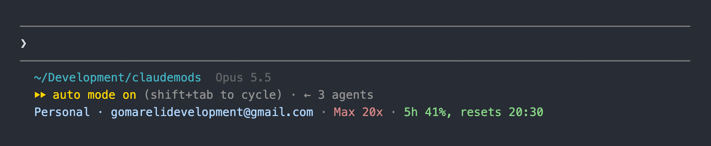
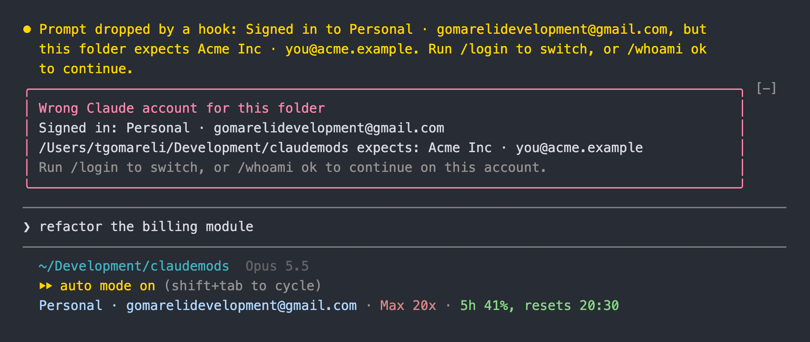

# whoami

[](https://github.com/tornikegomareli/claude-whoami/releases/latest)
[](LICENSE)
[](https://code.claude.com/docs/en/plugins/mods/overview)

**A Claude Code mod that shows which Claude account you are signed in to**: the organization, the email, the plan and how much of your usage limit is left, in one quiet line under the prompt. It also stops you from working in a folder on the wrong account.

<p align="center">
  
</p>

<p align="center">
  <a href="#install">Install</a> · <a href="#what-you-see">What you see</a> · <a href="#pin-an-account-to-a-folder">Pin an account</a> · <a href="#settings">Settings</a> · <a href="#what-it-can-reach">What it can reach</a>
</p>

## Why

With a personal account and one or more work organizations, Claude Code does not show which one the session runs on. You find out from a bill, an empty limit, or an admin. whoami keeps the answer on screen.

## Install

Inside Claude Code (2.1.296 or later):

```
/plugin install whoami --marketplace tornikegomareli/claude-whoami
/reload-plugins
```

<details>
<summary><strong>From the terminal, or from a clone</strong></summary>

```sh
claude plugin marketplace add tornikegomareli/claude-whoami
claude plugin install whoami@claude-whoami
```

Or load it from a clone for one session:

```sh
git clone https://github.com/tornikegomareli/claude-whoami
claude --plugin-dir ./claude-whoami
```

</details>

The installer may say that 2 config options are not set. The defaults are fine, and [`/config`](#settings) changes them.

Mods are an early-access Claude Code feature, and their API can change between releases.

## What you see

One line at the bottom of the prompt footer, each part in a soft color from your theme:

| Part | Example | Color |
|---|---|---|
| Account | `Acme · me@acme.com`, or `Personal · me@gmail.com` | blue |
| Plan | `Max 20x`, `Pro` | orange |
| Usage | `5h 41%, resets 20:30` | green under 50%, yellow from 50%, red from 80% |

`5h 41%` means you have used 41% of your current 5-hour usage limit, and `resets 20:30` is when it starts over. It is the same figure as `/usage`. The weekly limit joins the line once it is half used: `7d 63%, resets Fri`.

If the session runs on an API key, the line says `API key from ANTHROPIC_API_KEY` and shows no plan or usage.

`/whoami` prints the account, and the pin that covers the folder, if one does.

## Pin an account to a folder

Run `/whoami pin` in a folder to expect the current account there and in its subfolders. If a later session in that folder runs on another account:

- A red band above the prompt names both accounts.
- Prompts you type are held, and stay in the box.

<p align="center">
  
</p>

Run `/login` to switch, or `/whoami ok` to continue on the current account for this session.

| Command | Action |
|---|---|
| `/whoami` | Show the account, and the pin that covers this folder |
| `/whoami pin` | Expect the current account in this folder and its subfolders |
| `/whoami unpin` | Remove the pin that covers this folder |
| `/whoami ok` | Continue on the current account for this session |

Slash commands, and prompts from plugins or other sessions, are never held.

## Switch the account of a running session

This works with the Claude Accounts menu bar app, which keeps one Claude Code config folder per account and the list in `~/.claude-accounts/accounts.json`. The footer then shows the name and emoji you gave the account, such as `💼 Work · me@acme.com`.

Run `/account` to open a picker of your accounts. Arrows move, Enter switches this session, Esc closes. `/account work` or `/account 2` switches without the picker.

| Command | Action |
|---|---|
| `/account` | Pick an account for this session |
| `/account <name or number>` | Switch this session to that account |

The switch sets `CLAUDE_SECURESTORAGE_CONFIG_DIR` in the session, so Claude Code reads the other folder's Keychain login. Claude Code keeps the login it read for 30 seconds, so the switch then runs `/reload-plugins`, which drops that copy: the next request goes out on the new account. Only the login changes: the transcript stays in the folder the session started in. An account with no login is refused, so the session keeps a working one. The variable is internal to Claude Code and can change in a later version.

Once a session has run on a Team or Enterprise organization, Claude Code's policy keeps plugins from changing that variable for the rest of the session. `/account` then says so and gives the command that starts a new session on the account you picked, such as `CLAUDE_CONFIG_DIR=~/.claude-work claude`.

## Settings

Change them in `/config` (search for `whoami`), or with `/plugin configure whoami@claude-whoami`.

| Setting | Default | What it does |
|---|---|---|
| `fiveHourLimit` | `true` | On: show how much of the 5-hour usage limit is used, and when it resets. |
| `weeklyLimit` | `over-half` | `always`: always show the weekly usage limit. `over-half`: only once it is 50% used. `never`: do not show it. |
| `email` | `full` | `full`: show the whole email. `name`: only the part before `@`. `hidden`: no email, only the account or organization name. |

## What it can reach

whoami makes no network requests and calls no model.

| It reads or does | Through |
|---|---|
| Runs `claude auth status --json` for the account, organization and plan | `$.process.run` |
| Reads `organizationRateLimitTier` (the `20x`) and the email from `~/.claude.json`, or `<config folder>/.claude.json` | `$.fs.read`, `$.env.get` |
| Reads the account names and emoji in `~/.claude-accounts/accounts.json` | `$.fs.read` |
| Sets `CLAUDE_SECURESTORAGE_CONFIG_DIR` when you switch with `/account`, then runs `/reload-plugins` | `$.env.set`, `$.command.run`, `$.clock` |
| Asks whether the session uses a login or an API key. It reads only the credential's kind, never the credential | `$.session.authorize` |
| Reads the usage-limit figures that `/usage` shows | `session.measure`, `$.session.usage` |
| Keeps your pins (folder and account) between sessions, in its own store under the Claude Code configuration folder | `$.store` |
| Drops a typed prompt while the folder's pin does not match | `prompt.submit` |
| Draws the footer line, the red band, and the `/account` picker | `ui.render`, `$.ui.open` |

`claude auth status` reports `ANTHROPIC_API_KEY` even when the session declined that key and uses the login, so whoami asks the session which credential it uses before it trusts that report.

`claude plugin validate .` prints every hook and call.

## Develop

```sh
claude --plugin-dir .   # load it; saving a file reloads it
claude plugin validate .
claude plugin test .
```

## License

[MIT](LICENSE)
